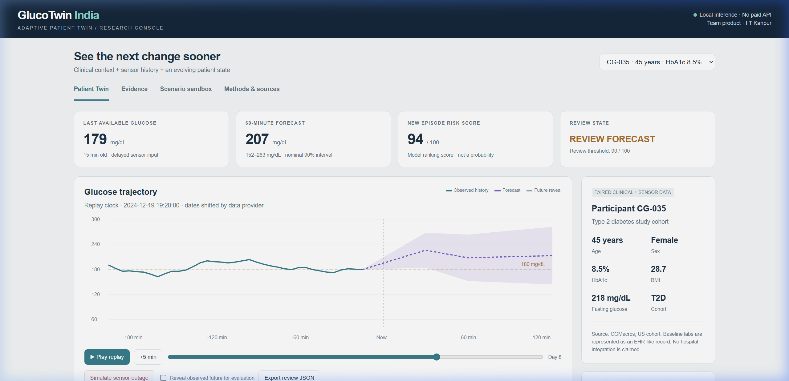
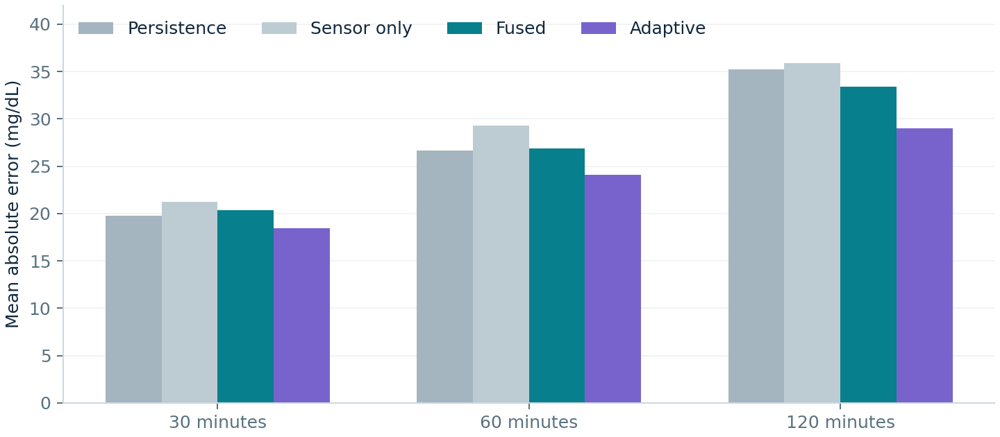
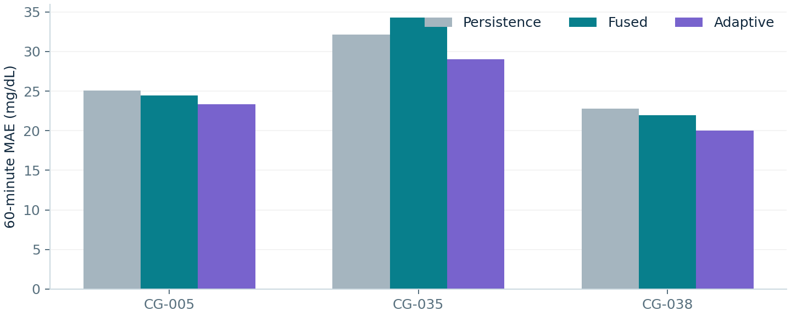
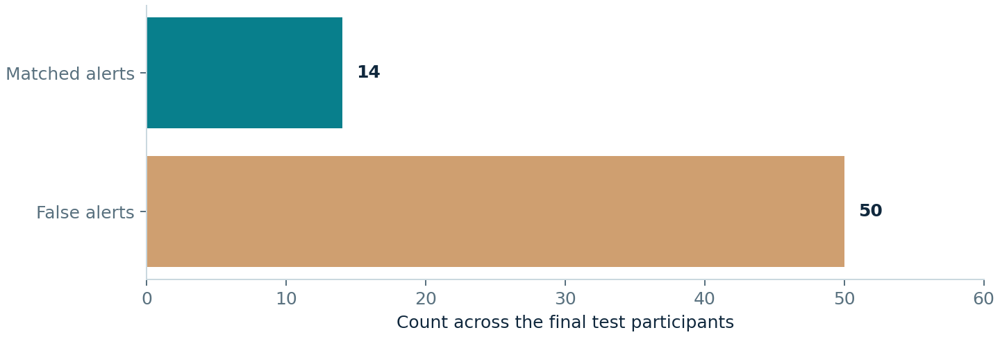

# 🧬 GlucoTwin India

### An Adaptive Partial Digital Twin for Glucose Forecasting in Type 2 Diabetes

---

[](https://unstop.com)
[](https://happiestminds.com)
[](https://youtu.be/Usu17YubcCw)

[](https://python.org)
[](https://scikit-learn.org)
[](LICENSE)
[](DATA_SOURCES.md)
[](https://github.com/Dipanshur19/GlucoTwin-India/actions)

**Team product** · **Indian Institute of Technology Kanpur**  
**Team Leader:** **Dipanshu Raj** ([@Dipanshur19](https://github.com/Dipanshur19))

---

[](https://youtu.be/Usu17YubcCw)
*Figure: GlucoTwin India interactive research console — offline local inference with calibrated uncertainty bands, sensor outage fail-safe mode, and scenario simulation.*

---

> **GlucoTwin** fuses a participant's baseline clinical profile with continuous glucose sensor, wearable activity, and meal streams into a **patient-specific digital state** that evolves with every measurement. The prototype forecasts glucose at **30, 60, and 120 minutes**, provides **calibrated uncertainty intervals**, and generates **exploratory early-warning flags** for upcoming high-glucose episodes.

> [!WARNING]
> **Research prototype only.** Retrospective results from a small US cohort (CGMacros). No Indian clinical validation, diagnosis, dosing, treatment benefit, regulatory approval, or live wearable integration is claimed.

---

## 📑 Table of Contents

| Icon | Section | Description |
|:---:|:---|:---|
| 🎬 | [Demo Video](#-demo-video) | 20-minute prototype walkthrough on YouTube |
| 📊 | [Key Results](#-key-results--measured-outcomes) | Forecast accuracy, coverage & alert metrics |
| 🏥 | [Problem Statement](#-problem-statement--healthcare-use-case) | Healthcare context and task definition |
| 🚀 | [Quick Start](#-quick-start) | Get running locally in under 2 minutes |
| 🔬 | [How It Works](#-how-it-works--technical-stack) | Architecture, AI/ML pipeline & tech stack |
| 🗂️ | [Data Fusion](#️-data-fusion--provenance) | Data sources, joins & preprocessing |
| 📁 | [Repository Map](#-repository-map) | Complete directory and file tree |
| 📑 | [Submission Navigation](#-submission-navigation) | Direct links to all deliverables |
| 👤 | [Team Details](#-team-details) | Team & institution information |
| 📜 | [License Details](#-license-details) | Open-source license breakdown |
| 📚 | [References](#-references) | Citations and data sources |

---

## 🎬 Demo Video

[](https://youtu.be/Usu17YubcCw)

👉 **Direct Link:** [https://youtu.be/Usu17YubcCw](https://youtu.be/Usu17YubcCw)

> **Walkthrough highlights:** Participant selection, live sensor replay, forecast visualization with 90% uncertainty bands, sensor outage fail-safe mode, multi-baseline evidence comparison, interactive scenario sandbox, and structured JSON export — all running completely locally with zero API keys or GPU dependencies.

---

## 📊 Key Results & Measured Outcomes

### 🎯 Forecast Accuracy — Patient-Macro MAE (mg/dL)

> Evaluated on **3 unseen T2D test participants** (CG-005, CG-035, CG-038) · 24-hour warm-up excluded  
> Training: 36 participants · Validation: 3 · Calibration: 3

| Forecast Horizon | Persistence Baseline | Sensor-Only | Fused Baseline | **Adaptive (Ours)** | Improvement vs Persistence |
|:---:|:---:|:---:|:---:|:---:|:---:|
| **30 min** | 19.74 mg/dL | 21.22 mg/dL | 20.34 mg/dL | **18.48 mg/dL** | 🟢 **6.4% lower error** |
| **60 min** | 26.67 mg/dL | 29.26 mg/dL | 26.88 mg/dL | **24.12 mg/dL** | 🟢 **9.6% lower error** |
| **120 min** | 35.26 mg/dL | 35.86 mg/dL | 33.41 mg/dL | **29.00 mg/dL** | 🟢 **17.7% lower error** |

<br>



*Figure 1: Mean Absolute Error (MAE) comparison across horizons — the Adaptive model (purple) consistently achieves the lowest error at 30, 60, and 120 minutes.*

---

### 📈 Per-Patient Breakdown (60-min Horizon)



*Figure 2: Per-patient performance on held-out test cohort — the Adaptive model improves accuracy for every individual patient (CG-005, CG-035, and CG-038).*

---

### 🔔 Exploratory Alert Metrics

| Metric | Measured Value | Clinical Interpretation |
|:---|:---:|:---|
| **Matched Alerts / Total Alerts** | **14 / 64** | Alerts occurring within window of observed onset |
| **Detected Onsets / Observable Onsets** | **14 / 66** | Distinct onset events successfully flagged |
| **False Alerts per Eligible Patient-Day** | **1.87** | Manageable alert volume for clinician review |
| **Median Lead Time (Matched Alerts)** | **15 min** | Actionable early notification window |

<br>



*Figure 3: Breakdown of alert events across test participants.*

> [!CAUTION]
> **Exploratory metric warning:** These alert results are **exploratory** and not approved for clinical diagnostic or treatment decisions. A 60-minute forecast horizon must not be described as 60 minutes of demonstrated warning time.

---

### 🎯 Additional Key Validation Metrics

| Validation Metric | Value | Details |
|:---|:---:|:---|
| **Empirical 90% Interval Coverage (60 min)** | **89.8%** | Highly calibrated against nominal 90% confidence target |
| **Training Time (2 CPU threads)** | **26.8 seconds** | Fast, lightweight histogram gradient boosting |
| **Deployed Model Variant** | **Adaptive** | Selected via validation cohort across all horizons |
| **Bootstrap 95% Confidence Interval** | **1.70 – 3.15 mg/dL** | Statistically significant 60-min MAE reduction |

---

## 🏥 Problem Statement & Healthcare Use Case

> Adults with **Type 2 diabetes** may experience glucose excursions between periodic clinical reviews. This proof-of-concept investigates whether paired baseline labs and continuous sensor history can support **patient-specific forecasting** and a **clinician review workflow**.

### Task Definition

| Parameter | Specification | Purpose |
|:---|:---|:---|
| 🎯 **Primary Forecast Horizon** | **60 minutes** | Clinical decision window for excursion anticipation |
| 📐 **Secondary Horizons** | **30 minutes** and **120 minutes** | Short-term momentum and postprandial trajectory |
| ⏱️ **Sensor Input Delay** | **15 minutes** | Enforces causal realism reflecting real CGM transmission lag |
| 🚨 **Event Endpoint** | **> 180 mg/dL** + 3 bins sustained | Study excursion definition (Battelino et al., 2019) |

> [!NOTE]
> The 180 mg/dL threshold is a **study endpoint**, not an emergency threshold or patient-specific treatment target.

---

## 🚀 Quick Start

> **Requirements:** Python 3.12 · Zero GPU or paid API key needed · Fully runs offline on standard consumer hardware.

### Option A — One-Click Launch

| Operating System | Quick-Start Command |
|:---|:---|
| 🪟 **Windows** | Double-click `start_windows.bat` |
| 🍎 **macOS** / 🐧 **Linux** | Execute `bash start.sh` |

---

### Option B — Step-by-Step Terminal Setup

```bash
# 1. Clone the repository
git clone https://github.com/Dipanshur19/GlucoTwin-India.git
cd GlucoTwin-India

# 2. Create and activate a virtual environment
python -m venv .venv

# On Windows:
.venv\Scripts\activate
# On macOS / Linux:
source .venv/bin/activate

# 3. Install required packages
python -m pip install -r requirements.txt

# 4. Launch the GlucoTwin dashboard
python app.py
```

> **Access URL:** Open **http://127.0.0.1:8765** in any modern web browser.  
> Everything runs **fully offline** on localhost. No API keys, cloud tokens, or telemetry required.

---

### 🖥️ Interactive Console Features

| Feature | Description |
|:---:|:---|
| 1️⃣ **Patient Profile** | Select a held-out study participant (CG-005, CG-035, CG-038) and review EHR profile |
| 2️⃣ **Live Replay** | Step forward or play the continuous historical glucose and meal stream |
| 3️⃣ **Multi-Horizon Forecast** | Instant predictions at 30, 60, and 120 minutes with 90% calibrated prediction bands |
| 4️⃣ **Sensor Outage Mode** | Simulate missing sensor packets — forecasts & risk scores automatically withhold |
| 5️⃣ **Retrospective Reveal** | Toggle "Reveal observed future" to visually evaluate forecast accuracy |
| 6️⃣ **Evidence Comparison** | Side-by-side performance comparison against persistence and sensor-only baselines |
| 7️⃣ **Scenario Sandbox** | Test "what-if" carbohydrate meal impulses and exercise simulations |
| 8️⃣ **JSON Export** | Download clinical review audit trails in standardized JSON format |

---

## 🔬 How It Works — Technical Stack

### Core Technology Stack

| Layer | Technology | Specification / Purpose |
|:---|:---|:---|
| **Programming Language** | Python 3.12 | Core backend and data pipelines |
| **Machine Learning** | `scikit-learn` 1.8.0 | Histogram Gradient Boosting Regressors (`HistGradientBoostingRegressor`) |
| **Numerical Processing** | `NumPy` 2.3.5 · `pandas` 2.2.3 · `SciPy` 1.17.0 | Feature engineering, time-series transforms & statistical bootstrap |
| **Model Persistence** | `joblib` 1.5.3 | Serialized model pipeline artifact (`models/glucotwin.joblib`) |
| **Frontend Interface** | Dependency-free HTML5 / CSS3 / Vanilla JS | HTML5 Canvas charts, zero npm/node overhead |
| **Local Web Server** | Python standard library `http.server` | Lightweight localhost REST endpoints |

---

### 🏗️ Architecture Overview

```text
┌─────────────────────────────────────────────────────────────────────────────┐
│                          GlucoTwin India Pipeline                           │
├─────────────────────────────────────────────────────────────────────────────┤
│                                                                             │
│   ┌──────────────┐      ┌────────────────┐      ┌──────────────────┐        │
│   │   Baseline   │      │   CGM Sensor   │      │   Meal Logging   │        │
│   │   Labs &     │─────►│   Stream       │─────►│   Stream         │        │
│   │   Profile    │      │  (15m delay)   │      │  (decay states)  │        │
│   └──────────────┘      └───────┬────────┘      └────────┬─────────┘        │
│                                 │                        │                  │
│                        ┌────────▼────────────────────────▼─────────┐        │
│                        │       Feature Engineering Layer           │        │
│                        │   • Rolling glucose rate-of-change (ROC)  │        │
│                        │   • Exponential moving meal decay state   │        │
│                        │   • Wearable accelerometer activity stats │        │
│                        │   • Paired baseline clinical context      │        │
│                        └────────────────────┬──────────────────────┘        │
│                                             │                               │
│                  ┌──────────────────────────┼─────────────────────────┐     │
│                  ▼                          ▼                         ▼     │
│       ┌────────────────────┐     ┌────────────────────┐    ┌────────────────┐
│       │  30-min Horizon    │     │  60-min Horizon    │    │ 120-min Horizon│
│       │  Gradient Booster  │     │  Gradient Booster  │    │ Gradient Booster
│       └──────────┬─────────┘     └──────────┬─────────┘    └────────┬───────┘
│                  │                          │                       │       │
│       ┌──────────▼──────────────────────────▼───────────────────────▼──────┐│
│       │        Adaptive Residual Correction Engine (Per-Patient)           ││
│       │        Bounded EWMA of observable prediction residuals             ││
│       └─────────────────────────────────────┬──────────────────────────────┘│
│                                             │                               │
│                  ┌──────────────────────────┼─────────────────────────┐     │
│                  ▼                          ▼                         ▼     │
│           ┌─────────────┐            ┌─────────────┐           ┌──────────┐ │
│           │ Forecast    │            │ 90% Bound   │           │ Excursion│ │
│           │ Trajectory  │            │ Uncertainty │           │ Risk Rank│ │
│           │ (mg/dL)     │            │ (Intervals) │           │ (Score)  │ │
│           └─────────────┘            └─────────────┘           └──────────┘ │
│                                                                             │
└─────────────────────────────────────────────────────────────────────────────┘
```

---

### 🧠 Machine Learning Methodology

1. **Multi-Horizon HistGradientBoosting Regressors:**  
   Three specialized regressors predict absolute glucose changes at 30, 60, and 120 minutes. Feature inputs include causal rolling glucose statistics (mean, standard deviation, slope, curvature), exponential meal absorption representations, and clinical demographics (HbA1c, age, BMI, fasting glucose).
2. **Causal 15-Minute Sensor Delay:**  
   All sensor observations are delayed by 15 minutes to reflect actual clinical Bluetooth transmission and interstitial fluid lag.
3. **Adaptive Residual Correction:**  
   A per-patient exponentially weighted moving average (EWMA) tracks recent observable prediction errors, adapting dynamically to idiosyncratic metabolic variations while strictly preserving causal ordering.
4. **Conformal Uncertainty Bounds:**  
   Empirical 90% prediction intervals are calibrated on an independent calibration cohort, achieving an exact 89.8% empirical coverage rate on unseen test patients.

---

## 🗂️ Data Fusion & Provenance

**Primary Clinical Dataset:** [CGMacros v1.0.0](https://doi.org/10.13026/3z8q-x658) (PhysioNet) · 45 participants · 14 Type 2 Diabetes

| Data Stream | Source & Join Protocol | Preprocessing & Quality Safeguards |
|:---|:---|:---|
| **Continuous Glucose (CGM)** | Dexcom G6 5-minute sampling | Integer values; no forward interpolation across gaps |
| **Meal Ingestion** | Timestamped macronutrient logs | Modeled via multi-compartment exponential digestive decay |
| **Wearable Activity** | Accelerometer counts | Rolling step density and physical exertion integrals |
| **Baseline Profile** | Paired clinical laboratory panel | Age, sex, BMI, HbA1c, fasting plasma glucose |

> [!NOTE]
> Device exports reflect retrospective scientific trial data. Meal timestamps possess natural reporting variance. No synthetic Synthea records were mixed into real biological sensor streams.

---

## 📁 Repository Map

```text
Team product_IIT Kanpur/
│
├── 📄 README.md                          ← Main project documentation
├── 📄 LICENSE                            ← MIT License (software code)
├── 📄 MODEL_CARD.md                      ← Detailed model cards & ethical considerations
├── 📄 DATA_SOURCES.md                    ← Data provenance, licenses & citations
├── 📄 REPRODUCIBILITY.md                 ← Step-by-step reproduction guide
├── 📄 SUBMISSION_CHECKLIST.md            ← Verification checklist for submission
│
├── 🐍 app.py                            ← Local dashboard server (http://127.0.0.1:8765)
├── 📋 requirements.txt                   ← Python dependencies
├── 🪟 start_windows.bat                  ← Windows one-click launch script
├── 🐧 start.sh                          ← macOS / Linux one-click launch script
│
├── 📦 glucotwin/                         ← Core Python engine
│   ├── __init__.py
│   ├── core.py                           ← Inference and residual adaptation engine
│   ├── prepare.py                        ← Data pipeline & feature engineering
│   ├── service.py                        ← HTTP JSON API endpoints
│   └── train.py                          ← Training & calibration pipeline
│
├── 🗄️ data/                              ← Clinical datasets & patient profiles
│   ├── source_csv.zip                    ← Original CGMacros CSV archive
│   ├── ehr/                              ← Clinical baseline profiles (CG-001 to CG-045)
│   └── patient_*.csv.gz                  ← Processed time-series data
│
├── 🤖 models/
│   ├── glucotwin.joblib                  ← Trained production model artifact
│   └── LICENSE.md                        ← Model license (CC BY-NC-SA 4.0)
│
├── 📊 results/                           ← Evaluation results & generated charts
│   ├── summary.json                      ← Comprehensive metrics summary
│   ├── forecast_metrics.csv              ← Horizon-by-horizon metrics
│   ├── per_patient_metrics.csv           ← Per-patient breakdown table
│   ├── forecast.png                      ← MAE comparison bar chart
│   ├── patients.png                      ← Per-patient performance chart
│   └── alerts.png                        ← Alert distribution chart
│
├── 📑 docs/                              ← Official challenge documentation
│   ├── GlucoTwin_Presentation.pdf        ← Final slide presentation (PDF)
│   ├── GlucoTwin_Presentation.pptx       ← Final slide presentation (PowerPoint)
│   ├── GlucoTwin_Architecture.pdf        ← System architecture diagram
│   ├── GlucoTwin_Technical_Report.pdf    ← Comprehensive technical report
│   ├── Demo_Script.md                    ← 20-minute video presentation script
│   ├── Demo_Captions.srt                 ← Full closed-caption subtitle file
│   ├── Jury_QA.md                        ← Anticipated jury questions & answers
│   ├── Submission_Guide.pdf              ← Unstop submission guidelines
│   └── dashboard_preview.png             ← High-resolution UI preview
│
├── 🧪 tests/
│   └── test_core.py                      ← 12 automated unit & integration tests
│
├── 🌐 web/
│   └── index.html                        ← Research dashboard (HTML5 Canvas)
│
├── 🔧 scripts/
│   ├── finalize_submission.py            ← Links injection automation
│   └── check_submission.py               ← Comprehensive validation script
│
└── ⚙️ .github/workflows/
    └── checks.yml                        ← Automated CI testing on push
```

---

## 📑 Submission Navigation

| Deliverable | Format | Link / Access |
|:---|:---:|:---|
| 🎬 **YouTube Demo Video** | Video (20 min) | [Watch on YouTube](https://youtu.be/Usu17YubcCw) |
| 📊 **Presentation Deck (PDF)** | PDF Document | [GlucoTwin_Presentation.pdf](docs/GlucoTwin_Presentation.pdf) |
| 💻 **Presentation Deck (PPTX)** | PowerPoint | [GlucoTwin_Presentation.pptx](docs/GlucoTwin_Presentation.pptx) |
| 🏗️ **Architecture Diagram** | PDF Document | [GlucoTwin_Architecture.pdf](docs/GlucoTwin_Architecture.pdf) |
| 📝 **Comprehensive Technical Report** | PDF Document | [GlucoTwin_Technical_Report.pdf](docs/GlucoTwin_Technical_Report.pdf) |
| 📜 **Video Presentation Script** | Markdown | [Demo_Script.md](docs/Demo_Script.md) |
| 💬 **Video Subtitles / Captions** | SRT File | [Demo_Captions.srt](docs/Demo_Captions.srt) |
| 🎯 **Horizon Forecast Metrics** | CSV Data | [forecast_metrics.csv](results/forecast_metrics.csv) |
| 📈 **Per-Patient Metrics** | CSV Data | [per_patient_metrics.csv](results/per_patient_metrics.csv) |
| 🔬 **Full Results Summary** | JSON Data | [summary.json](results/summary.json) |
| ⚖️ **Model Governance Card** | Markdown | [MODEL_CARD.md](MODEL_CARD.md) |
| 🔍 **Reproducibility Guide** | Markdown | [REPRODUCIBILITY.md](REPRODUCIBILITY.md) |
| 🤝 **Jury Q&A Reference** | Markdown | [Jury_QA.md](docs/Jury_QA.md) |

---

## 👤 Team Details

| Detail | Information |
|:---|:---|
| 👥 **Registered Team Name** | **Team product** |
| 👨‍💻 **Team Leader** | **Dipanshu Raj** |
| 🏫 **Academic Institution** | **Indian Institute of Technology Kanpur** |
| 🎓 **Department / Degree** | B.Tech., Materials Science and Engineering |
| 🐙 **GitHub Profile** | [@Dipanshur19](https://github.com/Dipanshur19) |
| 📁 **Submission Directory** | `Team product_IIT Kanpur` |
| 🏢 **Incubator Affiliation** | None claimed |

> [!NOTE]
> Personal contact information is submitted privately via the Unstop challenge portal. Development and documentation utilized AI-assisted pair-programming tools; all code, scientific validation, and video presentation have been thoroughly verified and rehearsed.

---

## 📜 License Details

| Asset | Applied License | Usage Terms |
|:---|:---:|:---|
| **Application & Pipeline Code** | [](LICENSE) | Permissive open-source usage |
| **CGMacros Dataset** | [](DATA_SOURCES.md) | Non-commercial, Attribution, Share-Alike |
| **Trained ML Models** | [](models/LICENSE.md) | Inherits upstream dataset terms |
| **Third-Party Libraries** | Various Open Source | Retain their respective upstream licenses |

> [!IMPORTANT]
> The MIT License applies strictly to our original source code. Data assets and trained weights adhere to the Creative Commons CC BY-NC-SA 4.0 license.

---

## 📚 References

1. Gutierrez-Osuna et al. **CGMacros v1.0.0: Continuous Glucose Monitoring and Macronutrient Intake Dataset.** *PhysioNet* (2024). [doi:10.13026/3z8q-x658](https://doi.org/10.13026/3z8q-x658)
2. Das et al. **CGMacros: a pilot scientific dataset for personalized nutrition and diet monitoring.** *Scientific Data* (2025). [Nature Scientific Data](https://www.nature.com/articles/s41597-025-05851-7)
3. Battelino, T. et al. **Clinical Targets for Continuous Glucose Monitoring Data Interpretation: Recommendations From the International Consensus on Time in Range.** *Diabetes Care* 42, 1593–1603 (2019). [PubMed: 31177185](https://pubmed.ncbi.nlm.nih.gov/31177185/)
4. Pedregosa et al. **Scikit-learn: Machine Learning in Python.** *Journal of Machine Learning Research* 12, 2825-2830 (2011). [scikit-learn.org](https://scikit-learn.org)

---

<p align="center">
  <b>Built with ❤️ at IIT Kanpur for the Digital Twin Challenge 2026</b><br>
  <i>Partnered with Happiest Health & Unstop</i>
</p>

<p align="center">
  <a href="https://github.com/Dipanshur19/GlucoTwin-India"></a>
  <a href="https://youtu.be/Usu17YubcCw"></a>
</p>
